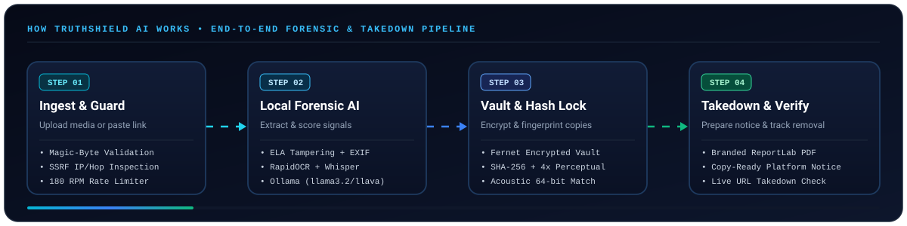
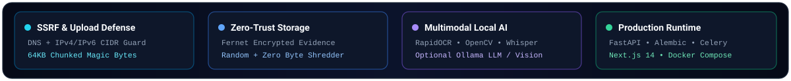

<div align="center">



<br />

[](#)
[](#)
[](#)
[](#)
[](#)

*“Together for a Safer Digital World”*

[Quickstart](#-quickstart-local-development) · [How It Works](#-how-truthshield-ai-works) · [Security Architecture](#-security--vault-hardening) · [Pages & UI](#-guided-workspace-pages) · [Docker](#-production-docker-deployment)

</div>

---

## ⚡ Why TruthShield AI?

Dealing with defamatory posts, manipulated media, leaked images, impersonation, or false accusations online requires speed, preserved proof, and clear platform notices. **TruthShield AI** is a local-first, privacy-preserving digital content protection workbench that runs **100% free without mandatory paid API keys** and launches immediately in **Direct Workspace Mode (`REQUIRE_AUTH=false` default)** with optional JWT multi-user auth when toggled (`REQUIRE_AUTH=true`).

<div align="center">
  
</div>

---

## 🔍 How TruthShield AI Works

1. **Check Content Safety (`Scan & Analyze`)**: Paste harmful text, check a suspicious URL through the SSRF-hardened scanner, or upload images, videos, or audio files.
2. **Preserve Proof (`Case & Encrypted Vault`)**: Create a structured investigation case, upload evidence verified by binary magic bytes, and store payloads encrypted at rest with Fernet (`AES-128-CBC + HMAC-SHA256`).
3. **Register Content Fingerprints (`Fingerprint Registry`)**: Generate cryptographic SHA-256 hashes, 4 image perceptual hashes (`pHash`, `dHash`, `aHash`, `wHash`), 64-bit audio acoustic fingerprints, and OCR text tokens to detect reposts and cropped duplicates.
4. **Generate Notice & Verify Removal (`Takedown Center`)**: Export a branded **ReportLab PDF forensic dossier**, prepare a copy-ready platform abuse notice backed by verified portal links, submit it on the target platform, and click **Verify Removal Status** to track whether the live URL still resolves or has been taken down.

> **Transparency Note:** Social platforms (Instagram, YouTube, X, etc.) only act on reports submitted through their own moderation queues or legal portals. TruthShield AI prepares the structured forensic evidence, PDF report, and takedown notice and tracks live URL availability cleanly from one place.

---

## 🧠 Forensic Multimodal Engines

<div align="center">
  
</div>

| Engine | Module | Local Capabilities |
| :--- | :--- | :--- |
| **Image Forensics** | `backend/app/services/media/image_analyzer.py` | SHA-256 + `pHash`/`dHash`/`aHash`/`wHash`, Error Level Analysis (ELA), EXIF provenance inspection, **RapidOCR** text extraction, chrominance screening |
| **Video Analysis** | `backend/app/services/media/video_analyzer.py` | OpenCV keyframe extraction, temporal perceptual hashes, per-frame **RapidOCR**, FFmpeg audio demuxing + Whisper transcription |
| **Audio Analysis** | `backend/app/services/media/audio_analyzer.py` | PyAV/WAV decoding, RMS & silence metrics, 64-bit spectral fingerprint, **Faster-Whisper** (`tiny`) local speech-to-text |
| **Text & Risk Rules** | `backend/app/services/media/text_analyzer.py` | Explainable linguistic scoring across threat, harassment, impersonation, and misinformation patterns |
| **SSRF-Safe URL Scanner** | `backend/app/services/media/url_analyzer.py` | Blocks `localhost`, RFC 1918 CIDRs, link-local cloud metadata (`169.254.169.254`), IPv4-mapped IPv6, inspects every redirect hop individually, and caps response reads at 2MB |
| **Hybrid Local LLM/Vision** | `backend/app/services/ai/orchestrator.py` | Optional live **Ollama** (`llama3.2` / `llava`) semantic classification controlled via Admin DB toggles (`AIModelConfig`) with automatic local rule fallback |
| **PDF Dossier & Removal** | `backend/app/services/reports/pdf_generator.py`<br>`backend/app/services/removal/workflow_engine.py` | Branded **ReportLab** PDF export, verified platform portal guidance, structured notice generation, and live URL removal checks |

---

## 🛡️ Security & Vault Hardening

- **Zero-Auth Workstation & Optional JWT Mode:** Launches with `REQUIRE_AUTH=false` so investigators can act immediately without login walls, while supporting `HS256` JWT multi-user auth + client-IP audit logging via `REQUIRE_AUTH=true`.
- **Magic-Byte Upload Verification (`file_validator.py`):** Inspects raw binary file headers (rejecting `MZ`, `ELF`, Mach-O, and `#!` script executables even with spoofed MIME headers) and enforces chunked upload limits.
- **Encrypted Evidence Vault (`encryption.py`):** Encrypts stored evidence bytes on disk using Fernet (`gAAAAA...` authenticated encryption) and overwrites bytes with random data + zeros before unlinking when deleting (`secure_shred_file`).
- **Sliding-Window API Rate Limiter (`rate_limit.py`):** Per-IP sliding window throttling (`RATE_LIMIT_RPM=180` default) returning HTTP `429` cleanly under burst abuse.
- **Schema Migrations & Async Workers:** Managed with **Alembic** (`backend/migrations/`) and **Celery + Redis** (`backend/app/workers/`).

---

## 🖥️ Guided Workspace Pages

Every view in `frontend/app/` includes plain-English action hints, clear workflows, and an interactive **How It Works** guide:

| Route | Component | Purpose |
| :--- | :--- | :--- |
| `/` | `frontend/app/page.tsx` | Workspace overview, safety KPIs, active case feed, and quick actions |
| `/analysis` | `frontend/app/analysis/page.tsx` | Multimodal safety scanner for text, suspicious URLs, images, video, and audio |
| `/cases` | `frontend/app/cases/page.tsx` | Case lifecycle management, JSON export, and encrypted evidence locker |
| `/fingerprints` | `frontend/app/fingerprints/page.tsx` | Visual/acoustic/OCR fingerprint registry and similarity matching |
| `/removal` | `frontend/app/removal/page.tsx` | Guided takedown notices, PDF report downloads, and live URL verification |
| `/admin` | `frontend/app/admin/page.tsx` | AI model toggles (Ollama LLM / Vision), worker controls, and audit logs |

---

## 🏛️ Project Structure

<details>
<summary>Click to expand full repository tree</summary>

```text
truthshield-ai/
├── backend/
│   ├── app/
│   │   ├── api/v1/          # REST routers: admin, analysis, auth, cases, dashboard, evidence, fingerprints, notifications, removal, reports
│   │   ├── core/            # config, database, deps, encryption, file_validator, rate_limit, security
│   │   ├── models/          # SQLAlchemy 2.0 ORM entities
│   │   ├── schemas/         # Pydantic v2 schemas
│   │   ├── services/
│   │   │   ├── ai/          # orchestrator & providers (Ollama + rule-based fallback)
│   │   │   ├── media/       # audio, hasher, image, ocr_engine, text, url, video analyzers
│   │   │   ├── removal/     # guided platform removal workflow & live URL checker
│   │   │   └── reports/     # ReportLab PDF dossier generator
│   │   ├── workers/         # Celery + Redis async background tasks
│   │   └── main.py          # FastAPI app entrypoint, middleware & lifespan bootstrap
│   ├── migrations/          # Alembic database schema revisions
│   ├── tests/               # Pytest verification suite
│   ├── alembic.ini
│   └── requirements.txt
├── frontend/
│   ├── app/                 # Next.js 14 App Router pages
│   ├── components/          # ActionHint, HowItWorksModal, Logo, Navbar, Sidebar
│   ├── lib/                 # API client & helpers
│   ├── types/               # Shared TypeScript interfaces
│   └── next.config.mjs      # Standalone production output
├── docker/
│   ├── Dockerfile.backend
│   └── Dockerfile.frontend
├── docs/
│   └── assets/              # Custom animated SVG banners & architecture diagrams
├── .env.example             # Configuration template
├── docker-compose.yml       # PostgreSQL 16, Redis 7, Backend, Celery Worker, Frontend
└── DEVELOPMENT_STATUS.md
```

</details>

---

## 🚀 Quickstart (Local Development)

### Prerequisites
- Python 3.11+ & Node.js 18+
- Optional: [Ollama](https://ollama.com/) (`ollama pull llama3.2` / `ollama pull llava`) for semantic LLM/Vision inference

### 1. Start the Backend (FastAPI)

```powershell
cd backend
python -m venv venv
.\venv\Scripts\Activate.ps1
pip install -r requirements-ml.txt  # or requirements.txt for lightweight API mode
alembic upgrade head
uvicorn app.main:app --host 127.0.0.1 --port 8000
```

- Interactive Swagger Docs: [http://localhost:8000/docs](http://localhost:8000/docs)

### 2. Start the Frontend (Next.js 14)

```powershell
cd frontend
npm install
npm run dev
```

- Web Workspace: [http://localhost:3000](http://localhost:3000)

---

## 🐳 Production Docker Deployment

Launch the complete stack (**PostgreSQL 16**, **Redis 7**, **FastAPI Backend**, **Celery Worker**, and **Next.js Standalone Frontend**):

```bash
cp .env.example .env
# Edit SECRET_KEY / database credentials in .env as needed
docker-compose up --build -d
```

- Frontend: [http://localhost:3000](http://localhost:3000)
- Backend API: [http://localhost:8000/api/health](http://localhost:8000/api/health)

---

## 🧪 Running Verification Tests

```powershell
# Backend Pytest suite
cd backend
$env:PYTHONPATH = (Get-Location).Path
.\venv\Scripts\pytest.exe .\tests -v

# Frontend strict production build
cd ..\frontend
npm run build
```

---

<div align="center">

**TruthShield AI** · *“Together for a Safer Digital World”*

</div>
